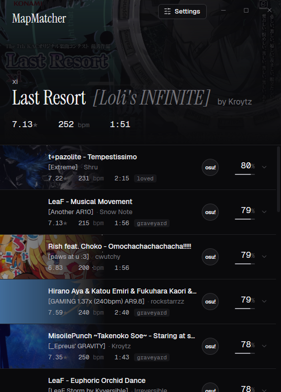
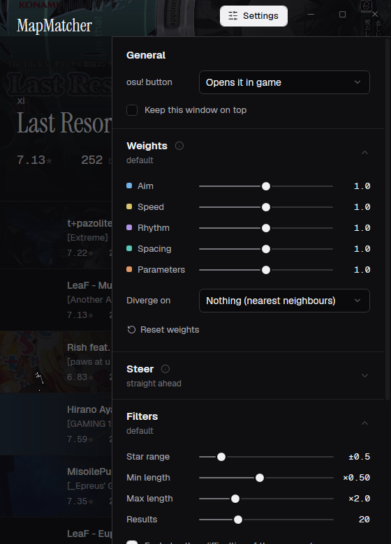

# osu!MapMatcher desktop

**Find the osu! maps that actually play like the one you have selected**, in a small
native Windows window next to the game. Same engine and API as
[osu!MapMatcher](https://github.com/Ayreth/OsuMapMatcher) and its
[tosu overlay](https://github.com/Ayreth/OsuMapMatcher-overlay), with **nothing else to install**:
no tosu, no Python, no browser.

<p align="center">
  
  &nbsp;
  
</p>

## Download

Grab `MapMatcher.exe` from the [latest release](https://github.com/Ayreth/OsuMapMatcher-desktop/releases/latest)
and run it. One file, the .NET runtime is included. Windows 10/11, x64.

## Works with

| Client | How the selected map is found | Mods |
|---|---|---|
| **osu!stable** | read from the game's memory, read-only (same patterns as tosu), then the `.osu` and background from your Songs folder | yes |
| **osu!lazer** and **Torii** | the `Game-wide working beatmap updated to …` line lazer writes to its log, looked up in a **copy** of `client.realm` (never the original). Gives the checksum, the `.osu` and the background from `files/` | not logged by lazer, so not followed |
| **tosu** (optional) | used instead when it is running | yes |

Torii keeps its data wherever its `storage.ini` points (often lazer's own `%AppData%\osu`); both are found.

Without any game: drop a `.osu` on the window, or copy a beatmap link / id / `.osu` file and press **Ctrl+V**.

## Using it

- Pick a map in song select; after a second the list fills in.
- The round **osu!** button on each suggestion opens it in game (`osu://b/…`, handled by osu!, lazer or Torii) or,
  if you prefer, on the website: *Settings → General → osu! button*.
- Click a suggestion to see **why** it was picked (where the distance comes from, what differs, what is the same), and
  **Maps like this one** to search from it without touching the game.
- **Settings**, next to the window controls, holds weights, steer, filters and connection. They are kept in
  `%AppData%\osu!MapMatcher\settings.json`.
- When a new version is released, a strip at the top of the window says so, with a link to download it.

## Privacy

Only the map's checksum goes to `api.ayreth.site`. A map the server has never seen is sent as its `.osu`, used and
dropped. If the local server from the main repository's `start.bat` is running, it is used instead and nothing
leaves your machine. Nothing is ever written to the game's folders.

## Build

```
dotnet publish -c Release -o publish
```

.NET 10 SDK, WPF. Produces a single self-contained `publish/MapMatcher.exe`.

## Credits

- Design: Kensa "Console" system. Fonts: [Geist / Geist Mono](https://github.com/vercel/geist-font) and
  [Instrument Serif](https://github.com/Instrument/instrument-serif), SIL Open Font License (see `Fonts/`).
- Memory patterns for osu!stable from [tosu](https://github.com/tosuapp/tosu).
- Original idea: [Xarib's OsuMapMatcher](https://github.com/Xarib/OsuMapMatcher).

Written with an AI assistant (Claude, by Anthropic); read the code before trusting it. A fan project, not affiliated
with or endorsed by ppy Pty Ltd, nor with Torii.

## License

MIT, see [LICENSE](LICENSE). Fonts are under their own OFL licences.
