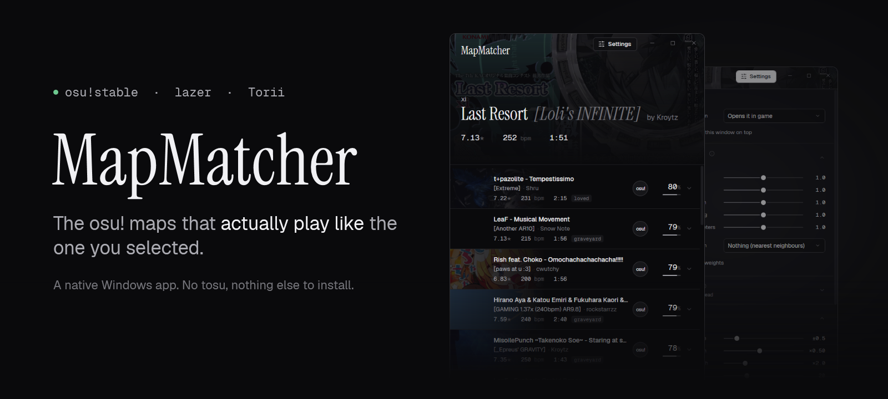

# osu!MapMatcher desktop



**Find the osu! maps that actually play like the one you have selected**, in a small
native window next to the game, on Windows, Linux and macOS. Same engine and API as
[osu!MapMatcher](https://github.com/Ayreth/OsuMapMatcher) and its
[tosu overlay](https://github.com/Ayreth/OsuMapMatcher-overlay), with **nothing else to install**:
no tosu, no Python, no browser.

<p align="center">
  
  &nbsp;
  
</p>

## Download

Everything is on the [latest release](https://github.com/Ayreth/OsuMapMatcher-desktop/releases/latest).
Each download carries its own .NET runtime: nothing else to install.

- **Windows 10/11 (x64)**: `MapMatcher.exe`. One file, run it.
- **Linux (x64)**: `MapMatcher-linux-x64.tar.gz`. Unpack it anywhere and run `MapMatcher/MapMatcher`.
  It needs what any desktop already has (X11 or XWayland, fontconfig, libICE/libSM) and a glibc distribution.
  To read osu!stable's memory, see [osu!stable on Linux](#osustable-on-linux).
- **macOS**: `MapMatcher-macos-arm64.zip` (Apple silicon) or `MapMatcher-macos-x64.zip` (Intel). Unzip and move
  `MapMatcher.app` to Applications. The app is signed ad hoc, not notarized, so Gatekeeper stops it the first time:
  right-click it, **Open**, then **Open** again. Or, in a terminal:
  `xattr -dr com.apple.quarantine /Applications/MapMatcher.app`.

## Works with

| Client | Windows | Linux | macOS | How the selected map is found | Mods |
|---|---|---|---|---|---|
| **osu!stable** | yes | yes, under Wine, if Linux lets it ([see below](#osustable-on-linux)) | through tosu only | read from the game's memory, read-only (same patterns as tosu), then the `.osu` and background from your Songs folder | yes |
| **osu!lazer** and **Torii** | yes | yes | yes | the `Game-wide working beatmap updated to …` line lazer writes to its log, looked up in a **copy** of `client.realm` (never the original). Gives the checksum, the `.osu` and the background from `files/` | not logged by lazer, so not followed |
| **tosu** (optional) | yes | yes | yes | used instead when it is running | yes |

Lazer keeps its data in `%AppData%\osu` (Windows), `~/.local/share/osu` (Linux, or `$XDG_DATA_HOME/osu`) or
`~/Library/Application Support/osu` (macOS). Torii keeps its data wherever its `storage.ini` points (often lazer's own
folder), else in `osu-torii` next to it; both are found.

macOS does not let one program read another's memory without root, so osu!stable (which only runs there through Wine)
is followed through [tosu](https://github.com/tosuapp/tosu) on a Mac. Lazer and Torii need nothing.

Without any game: drop a `.osu` on the window, or copy a beatmap link / id / `.osu` file and press **Ctrl+V**
(**Cmd+V** on macOS).

### osu!stable on Linux

osu!stable runs under Wine (or Proton, Lutris, osu-winello…). MapMatcher finds the `osu!.exe` process, reads its memory
with `process_vm_readv`, and turns the Windows paths osu! knows (its own folder, `BeatmapDirectory` from
`osu!.<user>.cfg`) into Linux paths through the Wine prefix (`WINEPREFIX`, else `~/.wine`, and its `dosdevices` links).

Most distributions set Yama's `ptrace_scope` to 1, which lets a program read another one's memory only if it started
it. The status line then says **osu! found, Linux denies memory access (see README)**, and MapMatcher waits for tosu
instead. Either of these lets it read osu! directly:

- give the MapMatcher binary that one capability (lasts until the file is replaced, e.g. by an update):

  ```
  sudo setcap cap_sys_ptrace=eip /path/to/MapMatcher/MapMatcher
  ```

- or relax Yama for every program until the next reboot:

  ```
  echo 0 | sudo tee /proc/sys/kernel/yama/ptrace_scope
  ```

  To keep it, put `kernel.yama.ptrace_scope = 0` in `/etc/sysctl.d/10-ptrace.conf`. With `ptrace_scope` 3 no program can
  read osu!stable (tosu included) until the next reboot.

Nothing is ever written to the game's memory or files either way.

## Using it

- Pick a map in song select; after a second the list fills in.
- The round **osu!** button on each suggestion opens it in game (`osu://b/…`, handled by osu!, lazer or Torii) or,
  if you prefer, on the website: *Settings → General → osu! button*.
- Click a suggestion to see **why** it was picked (where the distance comes from, what differs, what is the same), and
  **Maps like this one** to search from it without touching the game.
- **Settings**, in the top bar, holds weights, steer, filters and connection. They are kept in `settings.json` in:
  - Windows: `%AppData%\osu!MapMatcher`
  - Linux: `~/.config/osu!MapMatcher` (or `$XDG_CONFIG_HOME/osu!MapMatcher`)
  - macOS: `~/Library/Application Support/osu!MapMatcher`

  The copy of lazer's database goes to a cache folder (`%LocalAppData%\osu!MapMatcher`, `~/.cache/osu!MapMatcher`,
  `~/Library/Caches/osu!MapMatcher`) and can be deleted at any time.
- When a new version is released, a strip at the top of the window says so, with a link to download it.

On Windows the window draws its own title bar; on Linux and macOS it keeps the system's.

## Privacy

Only the map's checksum goes to `api.ayreth.site`. A map the server has never seen is sent as its `.osu`, used and
dropped. If the local server from the main repository's `start.bat` is running, it is used instead and nothing
leaves your machine. Nothing is ever written to the game's folders.

## Build

.NET 10 SDK. The UI is [Avalonia](https://avaloniaui.net/) 11, so every target builds from any OS:

```
dotnet build
dotnet test tests/MapMatcher.Tests

dotnet publish -c Release -r win-x64   -o publish/win-x64     # publish/win-x64/MapMatcher.exe, one file
dotnet publish -c Release -r linux-x64 -o publish/linux-x64   # publish/linux-x64/MapMatcher, one file
dotnet publish -c Release -r osx-arm64 -o publish/osx-arm64   # a folder: MapMatcher and its libraries
dotnet publish -c Release -r osx-x64   -o publish/osx-x64
```

All are self-contained. The macOS folder becomes `MapMatcher.app` (with `packaging/macos/Info.plist`, an icon and an ad hoc
signature) in [`.github/workflows/build.yml`](.github/workflows/build.yml), which builds all four on a `v*` tag and
attaches them to the release. The tests render the window headless (Avalonia.Headless + Skia) and save screenshots
under `tests/MapMatcher.Tests/bin/<config>/net10.0/screenshots/`.

## Credits

- Design: Kensa "Console" system. Fonts: [Geist / Geist Mono](https://github.com/vercel/geist-font) and
  [Instrument Serif](https://github.com/Instrument/instrument-serif), SIL Open Font License (see `Fonts/`).
- Memory patterns for osu!stable from [tosu](https://github.com/tosuapp/tosu).
- Original idea: [Xarib's OsuMapMatcher](https://github.com/Xarib/OsuMapMatcher).

Written with an AI assistant (Claude, by Anthropic); read the code before trusting it. A fan project, not affiliated
with or endorsed by ppy Pty Ltd, nor with Torii.

## License

MIT, see [LICENSE](LICENSE). Fonts are under their own OFL licences.
